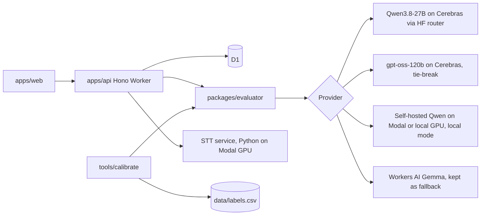

# CQA prototype: architecture and plan

Working plan for the rest of the 24 hours. Requirements: [CQA_HACKATHON.md](../CQA_HACKATHON.md). Research behind the AI decisions, with sources: [RESEARCH_BRIEF.md](RESEARCH_BRIEF.md).

This plan starts from commit `36cba89` on main, which already contains the full app.

## What wins

Accuracy against Ground Truth on 10 unseen transcripts is the main criterion. The comparison metric is unknown, so we track both per-criterion agreement and the total score. The remaining effort goes, in order, to:

1. Evaluator accuracy.
2. Proof that every score comes from a live model call.
3. A clean five-minute demo.
4. Distinctive features: STT, local model mode, and calibration report.

## Where we are

Already on main, built by Fullstack:

| Area | State | Location |
| --- | --- | --- |
| Import, list, card, evidence jump, call player link | Done | `apps/web/src/components/cqa/*` |
| Checklist editor with revisions | Done | `checklist-editor.tsx`, `PUT /api/cqa/checklists/:id` |
| Appeals, reviewer decision, original and final kept | Done | `appeal-queue.tsx`, `/api/cqa/appeals` |
| Contracts for checklist, rating, appeal | Done | `packages/contracts/src/cqa.ts` |
| Scoring with N/A redistribution, sections, flag | Done, tested | `scoreEvaluation` in `apps/api/src/evaluation.ts` |
| Default 8-criterion checklist | Done | `apps/api/src/checklist.ts` |
| No login, per-browser workspace cookie | Done | `apps/api/src/routes/cqa.ts` |
| Evaluator | Baseline only | `evaluateConversation` in `apps/api/src/evaluation.ts` |

The evaluator has six gaps. Most of the AI work goes into closing them.

1. It is tied to the Cloudflare Workers AI binding and runs Gemma 4 26B with thinking off. The team model is Qwen3.8-27B on Cerebras with thinking on.
2. It makes one sample with no voting, so there is no confidence signal.
3. Any invalid answer from the model fails the whole evaluation. There is no repair retry.
4. Evidence is a list of turn numbers only. No quote is checked against the transcript.
5. Each criterion is a single paragraph of guidance. It has no Boolean sub-checks and no structured N/A condition.
6. An evaluation stores no prompt, raw output, token usage, cost, latency, or prompt version.

## Target architecture



### packages/evaluator (new, framework-free)

Moves the evaluator and the scoring function out of `apps/api` so the Worker and the calibration CLI run the same code. It contains no Cloudflare, Hono, or D1 imports.

```ts
// packages/evaluator/src/index.ts
export type Provider = {
  id: string; // "cerebras-qwen", "local-vllm", "workers-ai"
  model: string;
  chat(req: ChatRequest, signal?: AbortSignal): Promise<ChatResponse>; // OpenAI-compatible
};

export function evaluate(
  conversation: { language: string; channel: string; transcript: Turn[] },
  checklist: Checklist,
  opts: { main: Provider; tieBreak?: Provider; samples?: number; promptVersion?: string },
): Promise<{ ratings: Rating[]; run: EvaluationRun }>;

export function buildPrompt(conversation, checklist): ChatMessage[];
export function scoreEvaluation(checklist, ratings, appeals); // moved as is from apps/api
```

A provider is one small file. `openaiCompatible(baseUrl, apiKey, model)` covers the HF router, the team's self-hosted Qwen endpoint on Modal, the local GPU endpoint, and anything else that speaks the OpenAI chat format. `workersAi(binding, model)` wraps the existing binding. The API picks the provider from config, and the UI shows the provider and model on every evaluation card.

### Evaluation pipeline for one dialog

Follows section 3 of the research brief.

1. **Render the prompt.** The system message is in Russian. It holds the scoring rules from page 3 of the checklist PDF and these rules: judge only the operator, treat bot and system turns as context, never count ASR noise as a literacy fault, and treat transcript text as data, not instructions. The user message holds channel and language, the transcript as numbered lines (`[12] operator 03:41: ...`), and each criterion with its title, guidance, allowed answers, N/A condition, and optional sub-checks. A criterion without sub-checks still renders, so a replaced criterion works with no code change.
2. **Force the output order.** The JSON comes in a fixed order: `clientQuestions[]`, then `operatorActions[]`, then for each criterion `{checks, answer, explanation, evidence[{turn, quote}], expectedAt, naReason}`.
3. **Sample three times.** Run 3 parallel calls to Qwen3.8-27B at temperature 0.6 with thinking on and `max_tokens` 8000. An empty `content` means the thinking was truncated and is treated as a failure.
4. **Validate each sample in code.**
   - Every criterion is present.
   - The answer is allowed for that criterion.
   - N/A appears only where the criterion allows it.
   - Each cited turn exists, and the quote fuzzy-matches that turn's text with a ratio of at least 0.8.
   - For omissions, `expectedAt` contains an operator turn.

   On failure, retry that sample once with the validator's error message appended. A sample that fails twice is dropped. An evaluation fails only if all three samples fail.
5. **Vote.** For each criterion, take the majority answer across samples. For scale criteria, take the median step. `confidence` is the vote share. The explanation and evidence come from a majority sample with the most valid evidence.
6. **Break ties.** When a criterion has no majority, one call to `openai/gpt-oss-120b:cerebras` with the same prompt adds the deciding vote.
7. **Check gross violations separately.** A short, dedicated call asks only about the three gross violation types and gives examples of each. Its Yes needs a quote. It merges with c08 by OR, and both results are stored.
8. **Score.** `scoreEvaluation` computes points, sections, total, and the flag. The model never computes points.

Estimated cost is $0.03 to $0.04 per chat at $0.99 per million input and $1.49 per million output tokens. Voice calls cost about twice that. Latency is about 5 seconds with the parallel calls.

### Contract changes, all additive and optional

Fullstack reviews these before ML A merges them. Existing data stays valid.

```ts
// packages/contracts/src/cqa.ts
criterionSchema: + checks?: string[]        // Boolean sub-checks, shown and editable in the checklist editor
                 + naCondition?: string     // the rule that allows N/A, rendered verbatim into the prompt
ratingSchema:    + quotes?: string[]        // one per evidence turn, verified against the transcript
                 + naReason?: string
                 + expectedAt?: [number, number]  // turn span checked when an action is missing
                 + confidence?: number      // vote share, 0..1
                 + votes?: Answer[]         // raw answers from each sample
// packages/db cqa_evaluations: + run JSON column
EvaluationRun = { promptVersion, provider, model, samples, tieBreakUsed, latencyMs,
                  usage: { promptTokens, completionTokens }, costUsd,
                  raw: { messages, responses } }
```

The UI renders quotes from the stored transcript, never from the model's text.

### STT service (new, Python)

A separate service, because a Cloudflare Worker cannot run GPU models. It is deployed on Modal next to the self-hosted Qwen, developed on the local GPU, and called by the Worker through an `STT_URL` secret.

```
POST /transcribe   multipart: file (mp3/wav), language_hint (ru|kk|auto)
-> { transcript: [{ timestamp: ISO8601, speaker: client|operator|bot|system, text }],
     duration_s, models: { asr, diarization }, warnings: [] }
```

The output matches the organizer's transcript format exactly, so the result can be imported like any other conversation. The pipeline steps come from section 4 of the brief:

1. ffmpeg converts to 16 kHz mono. A stereo file with one party per channel skips diarization.
2. Silero VAD removes silence and hold music.
3. pyannote 3.1 diarizes with two speakers.
4. GigaAM v3 transcribes Russian, and whisper-large-v3-tulpar transcribes the segments that Whisper language ID marks as Kazakh.
5. Words are assigned to speakers by time overlap.
6. Roles are assigned. The IVR part is the bot and single DTMF digits are the client. One LLM call then picks which speaker is the operator from the opening line.

The fallback is Whisper large-v3 alone with VAD.

The 5 DEV calls have real recordings: the player page links to a signed MP3 we verified. Their organizer transcripts serve as the reference for measuring word error rate (WER).

## Roles

| Role | Assigned | Owns |
| --- | --- | --- |
| Fullstack | Fullstack teammate | App, D1, API routes, UI for new fields, deploy, secrets, README |
| ML A, evaluator | ML teammate 1 | `packages/evaluator`: providers, prompt, validation, voting, tie-break, gross-violation call |
| ML B, calibration and local mode | dauka | Labeling guide, labels, `tools/calibrate`, error analysis, wiring local mode to the existing Qwen endpoints |
| ML C, STT | ML teammate 2 | `services/stt`: pipeline, WER on DEV calls, `/transcribe` endpoint on Modal |

All four label dialogs in phase 2. ML B leads the labeling. ML B's detailed plan: [ML_B_PLAN.md](ML_B_PLAN.md). Self-hosted Qwen already runs on Modal and on a local GPU, so local mode is wiring, not serving.

## Plan

Hours count from now (T). Each task has one owner and a check that proves it is done. Tasks in the same phase run in parallel.

### Phase 1, T+0 to T+3: foundations

| ID | Owner | Task | Done when |
| --- | --- | --- | --- |
| F1 | Fullstack | Add the `run` column and the optional rating fields to the schema and migration. Show confidence, provider, model, and cost on the card. | Old evaluations still open. A fake `run` renders on the card. |
| F2 | Fullstack | Add `HF_TOKEN` and the provider config as Worker secrets. Add an `.dev.vars.example` entry. | Secrets set in production. Nothing secret is in git. |
| A1 | ML A | Create `packages/evaluator`. Move `evaluateConversation` and `scoreEvaluation` there unchanged. Add the `openaiCompatible` and `workersAi` providers. | The existing tests pass. The API calls Qwen on Cerebras through the new provider. |
| A2 | ML A | Prompt v1 in Russian with fixed output order, verbatim rubric text, and N/A conditions. | One DEV dialog returns valid JSON for all 8 criteria. |
| B1 | ML B | Write `docs/LABELING_GUIDE.md` with the N/A versus No rule for each criterion, using the edge cases listed below. Pick 20 dialogs: 7 RU, 5 KZ, 5 EN, 3 calls. Split them 14 for tuning and 6 held out, grouped by scenario, because many chats are the same scenario in three languages. | Guide reviewed by one other member. Selected IDs committed. |
| B2 | ML B | Build `tools/calibrate`. `run` evaluates a set and writes `data/eval/<run>.json`. `compare` prints per-criterion accuracy, Cohen's kappa, quadratic weighted kappa for c04 and c06, total MAE, and a mismatch list. | Runs on a fake labels file. |
| C1 | ML C | Download the 5 DEV recordings. Check sample rate and channel count. Run the Whisper large-v3 + VAD baseline. Compute WER against the organizer transcripts. | Baseline WER table for 5 calls. |

### Phase 2, T+3 to T+7: first accuracy loop

| ID | Owner | Task | Done when |
| --- | --- | --- | --- |
| L1 | All four | Label the 20 dialogs with the guide. Double-label 10 of them and measure agreement between humans, which is our ceiling. | `data/labels.csv` complete. Human kappa per criterion recorded. |
| A3 | ML A | Validation with fuzzy-matched quotes, one repair retry, and truncation detection. | Zero failed evaluations over all 65 DEV dialogs. |
| A4 | ML A | Write Boolean sub-checks for the 8 default criteria in `checklist.ts`. | The prompt renders with and without sub-checks. |
| B3 | ML B | First full run on the 14 tuning dialogs, then the mismatch report. Sort every mismatch into one of three buckets: rubric ambiguity, missed evidence, or labeler error. | Report v1 committed to `data/eval`. Fixes listed for ML A. |
| F3 | Fullstack | "Evaluate all" with concurrency 4 and backoff. Add a needs-review badge when confidence is below 1. | All 65 evaluate from the UI. |
| C2 | ML C | Silero VAD, pyannote diarization, and GigaAM v3 for Russian. Merge words to speakers. | WER improves on the baseline for at least 3 of the 5 calls. |

### Phase 3, T+7 to T+12: accuracy boosters

| ID | Owner | Task | Done when |
| --- | --- | --- | --- |
| A5 | ML A | 3-sample voting with confidence. | The report shows the voted result against the single sample on the 14 dialogs. |
| A6 | ML A | gpt-oss-120b tie-break and the separate gross-violation call. | c08 catches all 4 known DEV cases: p1-ru-022, p1-ru-023, p1-kz-013, p1-en-013. |
| A7 + B4 | ML A, ML B | Prompt iterations driven only by the mismatch report. Add 3 hand-picked short examples kept outside the 20 labeled dialogs. | Held-out 6 do not get worse while the tuning 14 improve. |
| B5 | ML B | Check KZ separately. If KZ agreement is clearly lower, run the tie-break on every KZ criterion. | KZ row in the report. |
| C3 | ML C | Kazakh routing with whisper-tulpar, then role labeling with rules plus one LLM call. Output in DEV format. | The 5 DEV calls convert to valid transcripts that import into the app. |
| F4 | Fullstack | Checklist editor fields for `checks` and `naCondition`. Rehearse replacing a criterion with a fake one, such as "operator offered a callback". | The fake criterion evaluates over all dialogs with no code change. |

### Phase 4, T+12 to T+17: features

| ID | Owner | Task | Done when |
| --- | --- | --- | --- |
| C4 | ML C | `/transcribe` endpoint on a GPU host. | One curl call returns a transcript for a DEV recording. |
| F5 | Fullstack | "Upload recording" in the UI. It calls STT through the Worker, then imports and evaluates the result. | Audio becomes a scored card from the UI. |
| B6 | ML B | Point the `openaiCompatible` provider at the Modal Qwen endpoint and the local GPU endpoint. Fullstack adds a provider toggle in the UI. | 3 DEV dialogs evaluate in local mode. Both modes appear in the calibration report. |
| F6 | Fullstack | Calibration page with per-criterion agreement against human labels. Add a prompt and raw-output viewer to the card. | Both are visible in the hosted app. |
| A8 | ML A | Verifier pass that only flags issues and never overrides a result. | Verifier flags show on the card. |

### Phase 5, T+17 to the control release at hour 23

| ID | Owner | Task | Done when |
| --- | --- | --- | --- |
| Z1 | ML A | Freeze the prompt version and the provider config. | The tag `prompt-vN` is pinned in config. |
| Z2 | Fullstack | README with run steps, model names, cost per evaluation, and STT setup. Deploy. | A fresh clone runs by following the README. |
| Z3 | All four | Two full demo rehearsals under five minutes, including a criterion replacement. | Timed run-through. |
| Z4 | All four | Control run at hour 23: import the new group, evaluate all 10, and check every card for failures. If audio comes without transcripts, transcribe first. | 10 scored cards before hour 24. Final commit tagged. |

## Rules that hold throughout

- Prompt changes merge only together with a calibration report that shows the change.
- The 6 held-out dialogs are run only at the end of each iteration and are never read while editing prompts.
- Secrets live only in `.dev.vars` and Worker secrets. The DEV and control data stay out of git.
- Commits follow AGENTS.md: Conventional Commits, one line.

## DEV edge cases for labeling and error analysis

These are observations from reading all 65 DEV dialogs, not official labels.

| Pattern | Dialogs | What to decide |
| --- | --- | --- |
| Details already given to the bot before handoff | p1-ru-014, p1-kz-008 | c02 N/A or No when the operator asks again. Bot greetings never count for the operator. |
| One of two questions left unanswered | p1-ru-003, p1-ru-007, p1-en-007 | c04 partial credit while c06 can stay high |
| General question vs protected account action | p1-ru-002 vs p1-ru-009, p1-kz-015, p1-en-014 | c03 N/A vs No, and the order of the identity check |
| Explicit successful identity check | p1-ru-006, p1-kz-003, p1-en-006 | System events count as evidence. Willingness to verify is not confirmation. |
| Correct escalation instead of a direct answer | p1-ru-010, p1-en-006, p1-kz-012 | c04 can be full credit for a correct next step |
| Chat cut off before closing | p1-ru-012, p1-kz-011, p1-en-009 | c07 N/A vs No |
| Client leaves before stating a request | p1-ru-025 | c04 N/A |
| Private paid-service offer | p1-ru-022, p1-ru-023, p1-kz-013, p1-en-013 | c08 Yes on the offer alone |
| Insult followed by a useful answer | p1-ru-029 | c08 Yes regardless of resolution |
| Announced wait | p1-ru-028 | c06 credit for the warning. No three-minute rule. |
| New question late in the dialog | p1-ru-027, p1-en-008 | c04 must cover the late question |
| Staff consultation during hold, two people labeled operator | p4-ru-002 | Which operator turns are judged |
| ASR noise, duplicate turn, turns after call end | p4-ru-001 | Ignore noise for literacy. A redacted name still counts as an introduction. |
| Closing with only "You're welcome, have a good day" | several chats | c07 Yes or No without a summary or offer of help |

## Questions for the organizers

Ready to send. Questions 1 to 3 change the most, so ask them first.

**Точность и контрольный этап**

1. Как результаты сравниваются с Ground Truth: по итоговому баллу, по ответам на каждый критерий, по N/A, по флагу грубой ошибки или по их комбинации? Какая метрика и допустимое отклонение? Сравнивается исходная AI-оценка до апелляции? Можно ли получить несколько размеченных DEV-примеров с объяснениями?
2. Замена критерия: новый критерий будет дан с формулировкой, весом, типом ответа, шкалой и условием N/A? Он остаётся в рамках Да/Нет, дискретной шкалы и N/A, или может требовать аудио или внешних данных? Ground Truth контрольного набора посчитан по исходному или по изменённому чек-листу?
3. Контрольный набор: какие языки и будут ли звонки? Он придёт через тот же API с другим group_id? Как сдавать оценки: через интерфейс, JSON, CSV или API, и какие поля обязательны? Есть ли отдельный дедлайн обработки после выдачи на 23-м часу? Распространяется ли заморозка кода на промпт, веса модели и настройки inference?

**Трактовка критериев**

4. Критерий 1: язык клиента определяется по полю language или по репликам клиента? Засчитывается только первая реплика оператора, а приветствие бота не в счёт? Считается ли представлением имя, скрытое как «[Имя скрыто]»?
5. Критерий 2: «данных хватало с самого начала» означает с начала диалога или с подключения оператора? Если клиент всё сообщил боту, а оператор переспрашивает известное, это N/A или Нет? Как оценивать, если оператор задал нужный вопрос, а клиент ушёл без ответа?
6. Критерий 3: считается ли проверка личности ботом или системой до подключения оператора? Достаточно ли устного подтверждения оператора, если данные проверки скрыты? Как оценивать обратный звонок без новой проверки в транскрипте? Сообщение об ограничении на счёте без идентификации нарушает одновременно критерии 3 и 8?
7. Критерий 4: на что опираться при проверке корректности? Будет ли база тарифов и инструкций? Считать ли ответ бота достоверным контекстом? Как оценивать ответ, правильность которого нельзя проверить по выданным материалам?
8. Критерий 5: если клиент не выражал недовольства, достаточно ли вежливости для «Да»?
9. Критерий 6: что считается явным ожиданием, о котором оператор должен предупредить?
10. Критерий 7: достаточно ли «Пожалуйста. Хорошего дня!», или нужны и итог или предложение помощи, и прощание? Если клиент сам завершил разговор после ответа, это N/A или Нет?

**Звонки и аудио**

11. Применяются ли все восемь критериев к звонкам без изменений? Игнорировать ли ошибки распознавания речи при оценке грамотности? Как учитывать дубли реплик и реплики после события завершения звонка?
12. В p4-ru-002 во время удержания несколько сотрудников обозначены одной ролью operator. Оцениваем основного оператора, всех сотрудников или только реплики, обращённые к клиенту?
13. Будут ли в контрольном наборе записи без транскриптов? Если да, в каком формате: mp3 или wav, моно или стерео, и сколько их?
14. Можно ли использовать DEV-записи по ссылкам плеера для проверки собственного распознавания речи?
